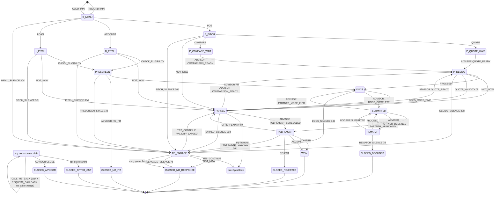

# Journey bot ("Welcome to Close")

The journey bot (module 016) walks a business customer on WhatsApp from
the first message to a closed deal for one of three products — a **POS
terminal**, a **business account** or a **business loan** — and hands
the steps only a person can take to an advisor as decisions on the
Journeys screen. It is off until an admin switches it on for the
account. This page is the operator contract; the behaviour itself is
the shipped workflow `src/lib/journeys/workflows/taamul-welcome-to-close.v1.json`
(`workflow_key` `taamul_welcome_to_close.v1`).

> Apply `supabase/migrations/086_journeys.sql` (re-runnable) before
> switching it on.

## What the bot does

1. **Welcome → Menu.** A customer who writes in gets the welcome menu
   (POS / Business account / Business loan) — when _Start on first
   inbound message_ is on, or when an advisor started a journey for
   them. A cold start from the CRM sends the opt-in welcome template
   instead, then waits on the same menu.
2. **Product pitch.** Inside the service window the pitch is a session
   message; outside it, the product's offer template.
3. **POS:** _Get a quote_ or _Compare my rates_ waits for the advisor
   (`QUOTE_READY` / `COMPARISON_READY`), then the quote or comparison
   goes out and the customer proceeds or not.
   **Account / loan:** _Check eligibility_ sends the eligibility
   prescreen; the advisor answers `FIT` or `NO_FIT`.
4. **Documents.** The documents request, reminders (at most 2 per
   stage) and _How to upload_ help; the advisor marks `DOCS_COMPLETE`.
5. **Submitted → partner decision.** The application status goes out;
   the advisor records `PARTNER_APPROVED`, `PARTNER_MORE_INFO` (back to
   documents) or `PARTNER_DECLINED` (re-match with another partner, or
   close).
6. **Fulfilment → won.** Delivery / bank match / loan offer is
   scheduled (`FULFILMENT_SCHEDULED`), and the thank-you (with _Refer a
   friend_ / _Other products_) closes the journey as **WON**.

**Parking and re-engagement.** A customer who taps _Not now_ or goes
quiet is parked (`PARKED`, with a reason); a quote or offer whose
validity lapsed parks with `VALIDITY_LAPSED`. A parked journey can be
woken by the customer or by an advisor decision, and gets at most one
re-engagement template (`taamul_reengage_30d`, marketing — so only with
opt-in). While parked, the bot sends at most one paid message.

**Closing reasons.** `WON / CONVERTED`; `NOT_WON` with
`OUTSIDE_APPETITE` (no fit), `DECLINED_NO_REMATCH`, `OFFER_REJECTED`,
`NO_RESPONSE`, `OPT_OUT`, or the advisor's own `reasonCode` (`CLOSE`).

## Timing

- **Quiet hours.** Timer-driven sends and cold starts — the paid and
  marketing messages the bot sends on its own — go out only between
  **09:00 and 20:00 Dubai time** (UTC+4); one due at night waits until
  09:00. Replies to the customer go out at once, and an opt-out
  confirmation is never held.
- **Service window.** WhatsApp allows free-form (session) messages for
  **24 hours** after the customer's last message. Outside it the bot
  sends a template, which Meta bills.
- **Free entry point.** A conversation opened from a
  **Click-to-WhatsApp ad** has a **72-hour** free window. QR codes,
  website links and posts are not ads: they open the normal 24-hour
  window.

## Consent

- Marketing templates go only to customers with a **recorded marketing
  opt-in** (`contacts.marketing_opt_in_at`, with its source). **An
  inbound chat is not an opt-in.** Utility messages about the
  customer's own application do not need it.
- **STOP**, **UNSUBSCRIBE**, **إلغاء**, **الغاء**, **ايقاف** and
  **إيقاف** (any case, surrounding punctuation ignored) opt the customer
  out at any point: the bot confirms (`taamul_optout_confirm`), records
  the opt-out on the contact and closes the journey as `OPT_OUT` — except
  an application already under way, which stays open with only its
  non-marketing reminders.
  **START** re-subscribes.
- Every send is checked again at delivery, so a marketing message
  queued before an opt-out is dropped, not sent. The opt-in welcome
  goes to a customer once, ever.
- **Do-not-contact** (`contacts.do_not_contact_at`) blocks cold starts
  and calls.

## Call me back

_Call me back_ works from any step. It opens a **callback task** for
an advisor (due in 15 minutes; out of hours, at 09:00), queues a
**callback request** for the phone system (click-to-call, module 015),
and answers with a short acknowledgement. One per 2 hours per journey.
There is no WhatsApp calling. A do-not-contact customer gets no call:
the advisor gets a `CALLBACK_BLOCKED_DNC` task instead.

## Templates the bot needs

Every MARKETING and UTILITY message is a template. On a **Meta**
number it must exist as an **APPROVED** template in the WABA under
exactly this name; on a **Whapi** number it must exist as a message
template (rendered locally, no approval). A missing or unapproved one
is skipped and opens one task per template per day. Quick-reply
buttons must read as the button titles below (or the account's own
titles): a template button comes back as its text.

| template                     | category  | buttons                                                                                                                                 |
| ---------------------------- | --------- | --------------------------------------------------------------------------------------------------------------------------------------- |
| `taamul_optin_welcome`       | MARKETING | POS terminal (`POS`), Business account (`ACCOUNT`), Business loan (`LOAN`)                                                              |
| `pos_intro_offer`            | MARKETING | Get a quote (`QUOTE`), Compare my rates (`COMPARE`), Talk to an advisor (`ADVISOR`), Not now (`NOT_NOW`), Call me back (`CALL_ME_BACK`) |
| `pos_switch_offer`           | MARKETING | Get a quote (`QUOTE`), Compare my rates (`COMPARE`), Talk to an advisor (`ADVISOR`), Not now (`NOT_NOW`), Call me back (`CALL_ME_BACK`) |
| `pos_quote`                  | UTILITY   | Proceed (`PROCEED`), Not now (`NOT_NOW`), Call me back (`CALL_ME_BACK`)                                                                 |
| `pos_rate_comparison`        | UTILITY   | Proceed (`PROCEED`), Not now (`NOT_NOW`), Call me back (`CALL_ME_BACK`)                                                                 |
| `acct_intro_offer`           | MARKETING | Check eligibility (`CHECK_ELIGIBILITY`), Not now (`NOT_NOW`), Call me back (`CALL_ME_BACK`)                                             |
| `loan_intro_offer`           | MARKETING | Check eligibility (`CHECK_ELIGIBILITY`), Not now (`NOT_NOW`), Call me back (`CALL_ME_BACK`)                                             |
| `acct_eligibility_prescreen` | UTILITY   | Call me back (`CALL_ME_BACK`)                                                                                                           |
| `loan_eligibility_prescreen` | UTILITY   | Call me back (`CALL_ME_BACK`)                                                                                                           |
| `pos_docs_request`           | UTILITY   | How to upload (`UPLOAD_HELP`), Call me back (`CALL_ME_BACK`)                                                                            |
| `acct_docs_request`          | UTILITY   | How to upload (`UPLOAD_HELP`), Call me back (`CALL_ME_BACK`)                                                                            |
| `loan_docs_request`          | UTILITY   | How to upload (`UPLOAD_HELP`), Call me back (`CALL_ME_BACK`)                                                                            |
| `docs_reminder`              | UTILITY   | Sending now (`SENDING_NOW`), Need more time (`NEED_MORE_TIME`), How to upload (`UPLOAD_HELP`), Call me back (`CALL_ME_BACK`)            |
| `pos_application_status`     | UTILITY   | —                                                                                                                                       |
| `loan_application_status`    | UTILITY   | —                                                                                                                                       |
| `acct_bank_matched`          | UTILITY   | Confirm (`CONFIRM`), Change slot (`CHANGE_SLOT`)                                                                                        |
| `declined_rematch`           | UTILITY   | Proceed (`PROCEED`), Talk to an advisor (`ADVISOR`), Call me back (`CALL_ME_BACK`)                                                      |
| `pos_delivery_scheduled`     | UTILITY   | Confirm (`CONFIRM`), Change slot (`CHANGE_SLOT`)                                                                                        |
| `loan_offer_received`        | UTILITY   | Accept (`ACCEPT`), Reject (`REJECT`), Call me back (`CALL_ME_BACK`)                                                                     |
| `pos_activated_thankyou`     | UTILITY   | Refer a friend (`REFER`), Other products (`CROSS_SELL`)                                                                                 |
| `acct_opened_thankyou`       | UTILITY   | Refer a friend (`REFER`), Other products (`CROSS_SELL`)                                                                                 |
| `loan_disbursed_thankyou`    | UTILITY   | Refer a friend (`REFER`), Other products (`CROSS_SELL`)                                                                                 |
| `taamul_reengage_30d`        | MARKETING | Yes, continue (`YES_CONTINUE`), Not now (`NOT_NOW`)                                                                                     |
| `taamul_optout_confirm`      | UTILITY   | —                                                                                                                                       |
| `acct_application_status`    | UTILITY   | —                                                                                                                                       |

The bot's SESSION messages are not templates: they are default,
**editable copy** (`src/lib/journeys/host/copy.ts`), sent as reply
buttons, a list or text inside the service window — `welcome_menu`,
`pos_pitch_in_window` (a list), `acct_pitch_in_window`,
`loan_pitch_in_window` and `callback_ack` (in-hours and out-of-hours
wording). Override any of it, and any button title, in the settings
`copy`.

## Advisor decisions

What the advisor can decide depends on the stage. `CLOSE` is available
in every open stage and needs a `reasonCode`, which becomes the
closing reason.

| stage            | decision → next stage                                                                              |
| ---------------- | -------------------------------------------------------------------------------------------------- |
| `P_QUOTE_WAIT`   | `QUOTE_READY` → `P_DECIDE`                                                                         |
| `P_COMPARE_WAIT` | `COMPARISON_READY` → `P_DECIDE`                                                                    |
| `PRESCREEN`      | `FIT` → `DOCS`; `NO_FIT` → `CLOSED_NO_FIT`                                                         |
| `DOCS`           | `DOCS_COMPLETE` → `SUBMITTED`                                                                      |
| `SUBMITTED`      | `PARTNER_APPROVED` → `FULFILMENT`; `PARTNER_MORE_INFO` → `DOCS`; `PARTNER_DECLINED` → `REMATCH`    |
| `REMATCH`        | `SUBMITTED` → `SUBMITTED`                                                                          |
| `FULFILMENT`     | `FULFILMENT_SCHEDULED` → stays (sends the update)                                                  |
| `PARKED`         | `QUOTE_READY` → `P_DECIDE`; `COMPARISON_READY` → `P_DECIDE`; `FULFILMENT_SCHEDULED` → `FULFILMENT` |

## Settings

`journey_settings`, one row per account (members read, admins write).
Admins edit it in **Settings → Inbox → Journey bot**, which also
shows the templates checklist per connected kind of number:

| field                 | meaning                                                                                                                                          |
| --------------------- | ------------------------------------------------------------------------------------------------------------------------------------------------ |
| `enabled`             | The bot answers on WhatsApp and the cron runs its timers. Off by default.                                                                        |
| `startOnFirstInbound` | A customer with no open journey who writes in starts one. Off: only a cold start from the CRM does.                                              |
| `taamulDid`           | E.164 number (`+9714…`) behind the _Call Taamul_ phone button; empty clears it.                                                                  |
| `copy`                | Overrides of the session copy: `{ "messages": { "<template>": { "body", "buttonLabel", "variants": { … } } }, "titles": { "<PAYLOAD>": "…" } }`. |

## APIs

Internal dashboard routes (signed-in session; errors `{ error, code? }`):

- `GET /api/journeys?state=&product=&limit=` — any member; the journeys
  of customers the caller can see, open first, then by last change.
  `limit` 1–200 (default 50). Answers `{ journeys: [{ id, contactId,
contactName, contactPhone, conversationId, state, product, entry,
outcome, open, createdAt, updatedAt, closedAt }] }`.
- `POST /api/journeys/start` `{ contactId }` — agents; cold start.
  409 with `code` `OPTED_OUT`, `DO_NOT_CONTACT`, `NO_MARKETING_OPT_IN`
  or `JOURNEYS_DISABLED`. Answers `{ fileId, state, outcome, warnings,
error? }`; a customer whose journey is already under way gets the
  `ALREADY_STARTED` warning and no change.
- `POST /api/journeys/{fileId}/advisor` `{ decision, reasonCode?,
validUntil? }` — agents; `validUntil` (ISO) is the quote or offer
  expiry. 400 `DECISION_NOT_AVAILABLE` for a decision the stage does
  not take, `REASON_REQUIRED` for `CLOSE` without a reason, or the
  engine's own code; 404 for a journey the caller cannot see; 409
  `CONFLICT` when it changed meanwhile. Answers `{ state, outcome,
warnings, error? }`.
- `GET /api/journeys/settings` — any member; `{ settings, defaultCopy }`.
  `PUT` — admins; any of `enabled`, `startOnFirstInbound`, `taamulDid`,
  `copy` (which replaces the whole override object); answers
  `{ settings }`.

In the 200 answers, `warnings` are the engine's notes (e.g. a guard
that stopped a send) and `error` means the step was saved but one of
its messages or tasks could not be delivered yet; the cron retries it.

## Cron

`GET /api/journeys/cron` (header `x-cron-secret: $AUTOMATION_CRON_SECRET`)
fires due timers and sends queued messages whose quiet-hours hold has
ended, for accounts with the bot on. Ping it every minute. The
automation cron (`GET /api/automations/cron`) also runs it, at most
once a minute per process, so an install that pings only that one is
covered.

## State diagram

